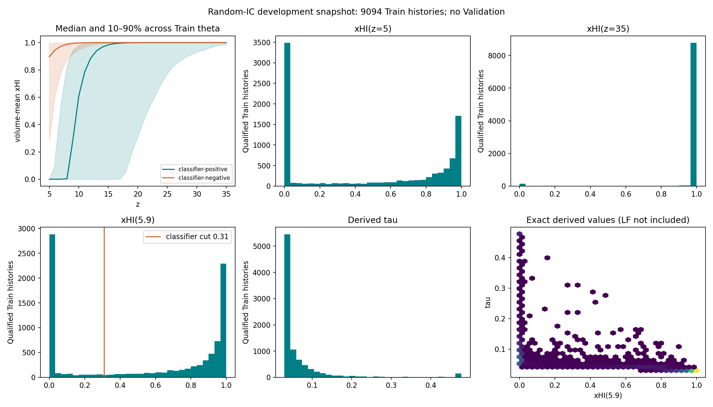
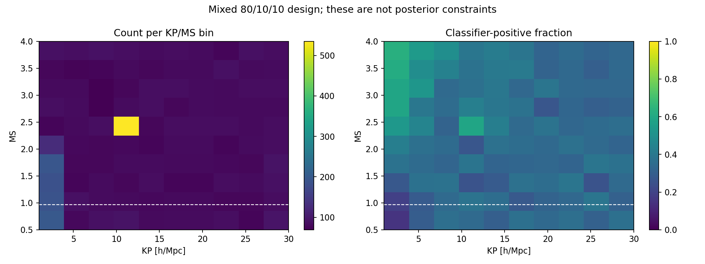
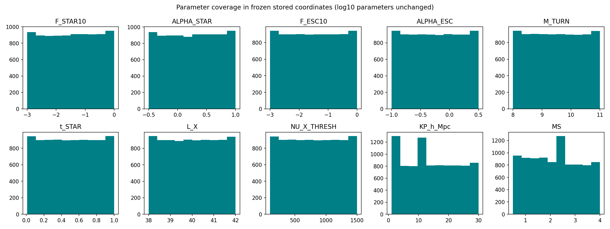
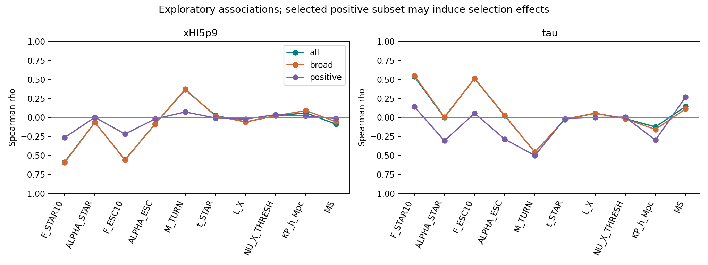
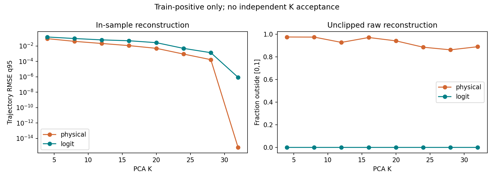

# Random-IC 现有数据分析：9,094 条 Train

## Material Passport

- Origin Skill: academic-research-suite / experiment-agent
- Origin Mode: validate
- Snapshot: 2026-10-13T23:54:32.738790+08:00
- Verification Status: VERIFIED（统计计算重复一致；不是模型科学验收）
- Version Label: random_ic_analysis_20261013
- 数据：random_ic_v2 已入库 Train；Validation=0；fixed_ic_v1 与 sealed labels 均未用于本次分析。

## 结论

当前数据覆盖完整声明参数范围，足以支持 classifier / history 模型的开发工作。分类边界样本少，独立随机 IC Validation 尚未生成；不能据此报告泛化精度或 KP/MS posterior。positive-only PCA 显示 K=28 是值得独立检验的压缩候选，尚未部署或正式选择 K。

全部 9,094 条通过 checksum、入库身份、参数/seed 与冻结设计一致性、native/target、32 节点网格、finite/range 检查；theta family 和随机 seed 均无重复。256 个固定抽样 Train-positive 点经原 tau/xHI 后处理重算，与保存值逐位一致。两个分析作业 2206704、2206711 重复计算的原有统计和 PCA 指标完全一致。没有新 exact simulation，没有训练新权重。

## 数据组成与 classifier

| Stratum | qualified | positive | positive fraction |
|---|---:|---:|---:|
| boundary | 908 | 373 | 41.08% |
| broad | 7,277 | 2,629 | 36.13% |
| continuous_ms | 454 | 91 | 20.04% |
| fixed | 455 | 279 | 61.32% |

总计 **3,372 positive / 5,722 negative**，cut 来自冻结原 likelihood：xHI(5.9)<0.31。两类 exact histories 均保留。混合设计接近 broad/view/boundary=80/10/10；这不是科学 prior 或 posterior 抽样，比例不应解释为宇宙参数的后验概率。

- cut±0.01：24 条；±0.02：53 条；±0.05：160 条。不能用这点样本宣称极低的边界 false-negative rate。
- 6,144 条受到原 xHI likelihood 惩罚。
- 3,372 条 positive 中，1,945 条同时满足 logL_tau≥−12.5，占 positive 的 57.68%。这只是单项阈值交集诊断，没有加入 LF，也不是 posterior acceptance。
- LF 未计算：9,094 条；LF-invalid 的已确认数量为 0，但 **不能写成 LF 全部有效**。history_valid=9,094，tau_valid=9,094。

## History 与派生量分布

| Quantity | q50 | q68 | q90 | q95 | min–max |
|---|---:|---:|---:|---:|---:|
| xHI(5) | 0.56125 | 0.891912 | 0.987793 | 0.996129 | 0–0.99983 |
| xHI(5.9) | 0.752642 | 0.940056 | 0.993411 | 0.997875 | 0–0.999838 |
| xHI(35) | 0.999795 | 0.999795 | 0.999795 | 0.999795 | 0–0.999795 |
| tau | 0.0372738 | 0.0544292 | 0.120252 | 0.202046 | 0.0299899–0.477472 |

xHI(5)>0.01 / 0.05 / 0.1 / 0.2 分别为 **5,713 / 5,568 / 5,462 / 5,290** 条。xHI(35)<0.99 为 **420** 条，<0.9 为 **265** 条。这些是保留的 domain warnings，不能因为 z=5 尚未完全电离而删标签。

131 条在全部输出节点均为 0；6,148 条至少一个节点落在 0.1<xHI<0.9。z=35 的多数值约 0.9997946，未被强制改为 1。

4,219 条在网格内恰有一个 xHI=0.5 交点；4,874 条没有交点，1 条有多个交点。仅对唯一交点报告中点，其 z 的中位数 8.352。没有为未跨越阈值的 history 伪造再电离中点。

相邻节点的非单调变化统计：超过 1e−6 的有 8,093 条，但多数幅度约 1.7e−6；超过 1e−4 / 0.001 / 0.01 的分别 **80 / 53 / 21** 条。后者可供进一步诊断；本轮不解释为 native bug，也不据此修改任何标签或强制单调。

## 参数覆盖与关联

KP/MS 的 10×10 二维网格没有空格，每格 69–535 条；固定 view 的集中区解释了部分高密度。每个输入的 10 个等坐标区间都已有覆盖。二维有覆盖并不保证十维所有局部区域已足够密集。训练设计按已存储的 log10 坐标采样，没有重复取 log。

broad 子集中，xHI(5.9) 与 F_STAR10 / F_ESC10 / M_TURN 的 Spearman rho 为 **−0.594 / −0.560 / +0.371**；与 KP / MS 为 **+0.089 / −0.057**。τ 与 KP / MS 为 **−0.159 / +0.112**。这些只是跨其他参数混合后的关联，不能据此删掉 KP/MS、忽视交互作用，或宣称 BT 参数已被约束。

fixed view 的 positive fraction 为 61.32%，continuous-MS view 为 20.04%，broad 为 36.13%。不同 view 的固定参数与覆盖域不同，不能把差异直接归因于 IC 或单个 BT 参数。

## Positive-only PCA 表示诊断

只在 **3,372 条 Train-positive histories** 上拟合 PCA；没有使用 negative、Validation 或 sealed。原始标签未变。logit epsilon=1e−6 仅用于该表示实验。下面是同一 Train 上的精确投影/重构误差，**没有神经网络误差，也不是独立 Validation**。

history 指标使用全部 3,372 条；派生量使用从该集合固定随机抽取的 256 条，所有 K 共用同一集合和原后处理。

| K（logit PCA） | trajectory RMSE q95 | trajectory max abs q95 | abs Δtau q90 | abs ΔlogL_tau q90 | abs ΔlogL_xHI q90 |
|---|---:|---:|---:|---:|---:|
| 4 | 0.14633 | 0.55538 | 0.019883 | 57.749 | 1.439 |
| 8 | 0.092748 | 0.39437 | 0.0048323 | 9.8917 | 2.2094 |
| 12 | 0.061664 | 0.26396 | 0.0017003 | 4.036 | 0.20251 |
| 16 | 0.047574 | 0.19146 | 0.00095393 | 2.0781 | 0.00058501 |
| 20 | 0.026868 | 0.099992 | 2.2642e-05 | 0.070905 | 0.00012786 |
| 24 | 0.0048479 | 0.019019 | 5.2899e-06 | 0.016116 | 8.3573e-05 |
| 28 | 0.0013411 | 0.0047661 | 3.4869e-06 | 0.011051 | 1.9936e-05 |
| 32 | 8.4779e-07 | 1e-06 | 1.1921e-07 | 0.00039908 | 1.9207e-14 |

K=28 的 history 重构明显优于 K≤16，也低于现有 *proposed* 表示预算中的 history q95 筛查值，值得独立检验。但总误差协议仍为待科学确认的提案，且本实验只有训练内重构，**没有据此冻结 K 或宣布通过**。完整 K=32 保留约 1e−6 的 epsilon 端点影响。

原始 xHI 空间 PCA 也测试了同样的 K。K=28 仍有 313 条出现超过 1e−6 的越界，最大幅度约 0.02194；没有通过 clip 隐藏。K=32 的越界仅约 1.68e−15，属于浮点精度，与低维截断造成的越界分开报告。raw PCA 的派生误差只计算严格在 [0,1] 内的重构，分母随 K 改变，不能拿这个受筛选子集声称全体精度。

## 失败与资源

在该汇总快照的 9,096 次 attempts 中，9,094 条合格，2 条 numerical failure（0.022%）。两条均报 InfinityorNaNError，参数和原失败产物完整保留，无重抽、改 seed 或修改分辨率。

两例 t_STAR 分别约 0.01493 和 0.01，NU_X_THRESH 分别约 1441.8 和 1428.8 eV，但只有两例，不能据此认定原因或删除该参数区域。故障明细和参数仅留在私有分析产物。

单条墙钟 q50/q90 为 419.45 / 497.71 秒（每条分配16 CPU）；峰值内存中位数约 7.54 GiB，最大约 7.70 GiB。生产已结算 17,362.77 core-hours，目录快照约 2.80 GB。分析作业只用 1 CPU，不改变生产并发。

## 下一步依据

1. 持续推进已授权的随机 IC 数据生产，保留所有 positive/negative 和失败记录。
2. 模型开发前优先具备一批冻结设计中的独立 random-IC Validation；目前的排程是 Train 后生成 Validation。本次分析未改排程或 split。
3. 用同一验证集比较 classifier FN、Direct ResMLP 与 K=28/32 PCA+MLP；不能用训练内重构替代验证。
4. cut 附近和 21 条较大非单调变化可作为后续开发诊断对象。IC audit 散布结果继续保留，random realization 数据不自动等价于已验证的 ensemble mean。

## 统计解释与可复现性

抽样单位是一条完整 theta/history，32 节点不是 32 个独立样本；图中 10–90% 是跨 theta 分布分位数，不是 IC 置信区间。所有分析均为探索性，没有假设检验或显著性筛选。

11/11 统计误用检查：分层报告避免混合趋势误读；不从分组比例推断个体/宇宙；positive 筛选可能诱导选择关联；未做 collider 控制或因果调整；明确 classifier 基率；不声称极值再测改善；保留失败分母；报告全部10参数关联且无p值挑选；固定分析快照/epsilon/K清单并标记探索性；关联不作因果解释；不作反向因果断言。

复现入口：`maintenance/random_ic/analyze_snapshot.py`，输入 allowlist 为 `results/random_ic_analysis_20261013/input_manifest.json`，协议与所有图表、CSV、JSON 保存在同目录。完整标签路径和逐样本记录保留在独立项目，不上传公开仓库；公开只发布本报告、聚合统计和图表。sealed labels 未读取，未运行生产 MCMC。
