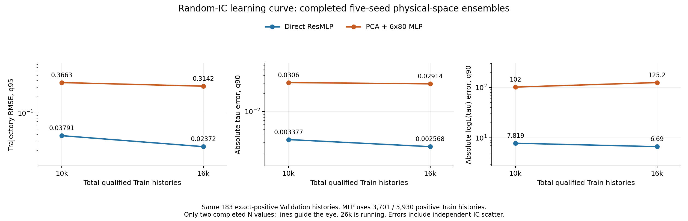
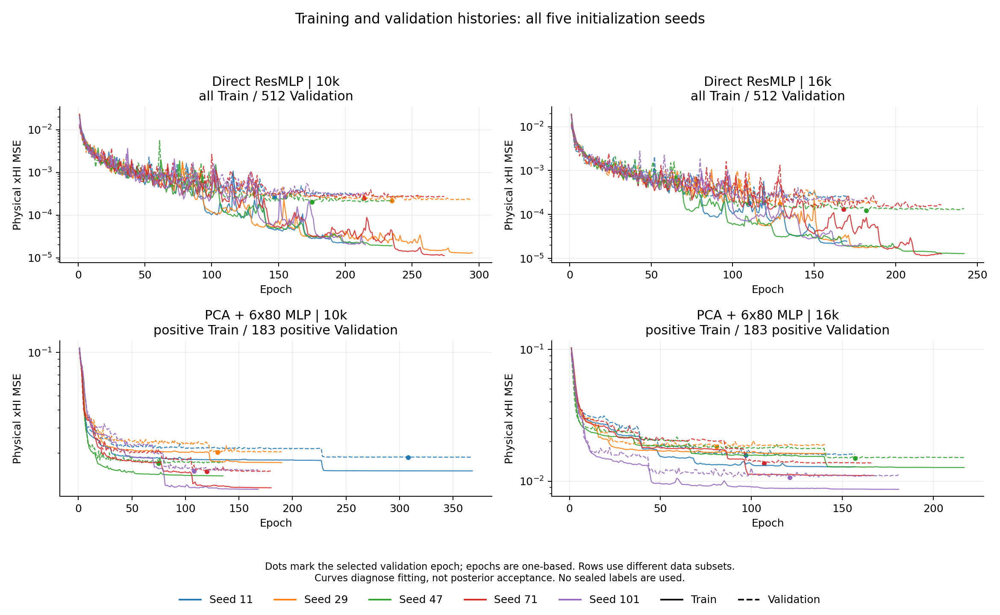

# Random-IC学习曲线（2026-10-18）

本轮根据已完成的10k和16k训练产物绘制两类图，全部保留五个seeds；26k仍在训练，未完成结果不进入图。

## 误差随训练样本数变化

横轴是总Train样本量，三列分别为history RMSE q95、绝对Δτ q90、绝对ΔlogLτ q90；蓝线为Direct，橙线为PCA+6×80 MLP。两种模型比较使用同一183条exact-positive Validation。Direct使用全部Train，MLP使用其中3701/5930条positive Train，因此不能把横轴误读为MLP正类样本数。

所有点均为五个成员先在物理xHI空间平均，再调用原后处理的实测指标；不是对指标或logits取平均。只有两个已完成N，连线仅帮助读图，不作样本复杂度拟合或100k精度外推。

[PDF](../site/learning_curves/error_vs_training_size.pdf)

## Epoch训练/验证曲线

两列是10k与16k；上排Direct、下排PCA+MLP。颜色对应五个初始化seeds，实线为Train MSE，虚线为Validation MSE；圆点为各seed选择checkpoint的最低Validation epoch。横轴从1开始；旧JSON中epoch从0开始。

Direct使用512条Validation，MLP使用183条positive Validation，不能将上下排loss当作相同样本集合的性能比较。各subplot纵轴采用对数尺度。可以观察到MLP训练误差停在较高平台；该图本身不能确定唯一原因或代替posterior验收。

[PDF](../site/learning_curves/training_validation_epochs.pdf)

图件源输入SHA256和完成作业记录保存在results/random_ic_learning_curves_20261018/manifest.json。仅使用已有汇总与训练曲线，没有读取sealed标签或运行新模拟。fixed-IC历史实验没有混入random-IC图。
